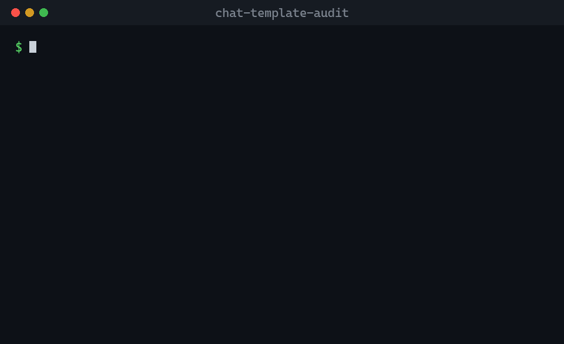

<div align="center">


# chat-template-audit

**Find the one bug that turns "load a chat model" into "run the model author's code":
a `chat_template` compiled by a non-sandboxed Jinja2 environment.**

[](https://github.com/samichellia90-bit/chat-template-audit/actions/workflows/tests.yml)




</div>

## The bug class

A chat model ships its prompt format as a **Jinja2 template**: `chat_template` in
`tokenizer_config.json`, a `chat_template.jinja` file, or `tokenizer.chat_template`
in GGUF metadata. Code that turns messages into a prompt compiles that string:

```python
from jinja2 import Environment
prompt = Environment().from_string(tokenizer.chat_template).render(messages=msgs)
```

When the model comes from an untrusted source — any public hub — that template is
**attacker-controlled Jinja**. A plain `Environment` or `Template` runs it with no
sandbox, so a crafted template reaches Python and executes code:

```jinja
{{ cycler.__init__.__globals__.os.popen('id').read() }}
```

Just loading and using the model is enough. This is exactly how **CVE-2024-34359**
(llama-cpp-python) and **CVE-2024-2952** (LiteLLM) worked. The fix is a Jinja
**sandbox** — `ImmutableSandboxedEnvironment` — on `jinja2 >= 3.1.6` (earlier
sandboxes have their own escapes: CVE-2024-56326, CVE-2025-27516).

`chat-template-audit` finds the render sites that skip that precaution.

## Validation — it catches the real CVEs, and clears the fixes

Run against the published vulnerable and patched releases, with nothing tuned to them:

| Package | Release | `chat-template-audit` says | |
|---|---|---|---|
| llama-cpp-python | `v0.2.71` (CVE-2024-34359) | **2 × REVIEW** — `jinja2.Environment` on `metadata["tokenizer.chat_template"]` | 🔴 |
| llama-cpp-python | `v0.2.72` (patched) | 0 REVIEW · 4 sandboxed render sites · 1 PIN (`jinja2>=2.11.3`) | 🟢 |
| LiteLLM | `v1.34.41` (CVE-2024-2952) | **1 × REVIEW** — `Environment().from_string(chat_template)` in `hf_chat_template` | 🔴 |
| LiteLLM | `v1.34.42` (patched) | 0 REVIEW · sandboxed · 2 PIN (jinja pinned below 3.1.6) | 🟢 |

On current releases of transformers, vLLM, SGLang, LiteLLM, text-generation-webui and
xinference, the model-supplied render sites are sandboxed and the tool reports them as
`SANDBOX`, not `REVIEW` — the ecosystem converged on `ImmutableSandboxedEnvironment`
after these CVEs. The value now is keeping it that way and catching the next regression.

## Install & use

```bash
pip install -e .                      # zero runtime dependencies

chat-template-audit path/to/repo      # human-readable, colored
chat-template-audit --format sarif .  # upload to GitHub code scanning
chat-template-audit --format json .   # machine-readable
chat-template-audit --strict .        # fail on CHECK and PIN too, not only REVIEW
```

Exit code is `1` when a `REVIEW` is found (`--strict`: also `CHECK`/`PIN`), so it drops
straight into CI or a pre-commit hook. Add `# chat-template-audit: ignore` on a render
line to suppress a reviewed false positive.

## What the verdicts mean

| verdict | exit≠0 | meaning |
|---|:--:|---|
| **`REVIEW`** | yes | a **model-supplied** template is compiled by a **non-sandboxed** environment. The bug. |
| **`CHECK`** | `--strict` | model-supplied template, but the environment is resolved only partly (sandboxed on some paths, or built elsewhere). Read it. |
| **`PIN`** | `--strict` | a sandbox is used, but the project's `jinja2` requirement admits a version `< 3.1.6`, whose sandbox has known escapes. |
| `SANDBOX` | no | compiled in a Jinja sandbox. Good. |
| `PLAIN` | no | non-sandboxed, but the template is not traced to a model (e.g. a developer constant). |
| `UNKNOWN` | no | render site whose environment could not be resolved and whose template is not model-traced. |

Each `REVIEW`/`CHECK` points at the render site **and** the line where the model-supplied
value enters, even across files.

## How it works

Pure static analysis — the scanned code is parsed with `ast`, never imported or executed.

- **Resolution.** jinja2 imports, aliases (`import jinja2 as j`), `jinja2.sandbox`
  attribute chains, star-imports, subclasses of `Environment`/`SandboxedEnvironment`,
  module-level and `self` environments, and factory functions are resolved — **across the
  modules of the scanned tree**, so a sandbox built in one file is recognised in another.
- **Taint.** A template is *model-supplied* when it derives from a name, attribute, dict
  key or file name containing `chat_template` / `tokenizer_config`. The taint follows
  assignments, `self` attributes, return values and arguments through a fixed-point pass
  over the call graph — the shape of CVE-2024-34359, where the template crosses a
  constructor and a `self` attribute, is caught.
- **Version pins** are read from `pyproject.toml` (PEP 621 and Poetry), `requirements*.txt`,
  `setup.py` and `setup.cfg`.

Rules: `CTA001` (REVIEW), `CTA002` (CHECK), `CTA003` (PIN) — emitted with CWE-1336 in SARIF.

## Limitations

- Static analysis: dynamic `getattr`, config-driven class loading or `eval` can hide a
  render site. A `REVIEW` is a lead a human confirms, not a proven exploit — reachability
  decides it (e.g. a library may render a model template with a plain `Environment` yet
  drop any untrusted string before it reaches the compiler).
- Python only. Templates compiled in other languages are out of scope.
- **For defensive use and responsible disclosure only.** If you confirm a real issue in a
  project you do not own, report it privately to its maintainers.

## License

MIT — see [LICENSE](LICENSE).
